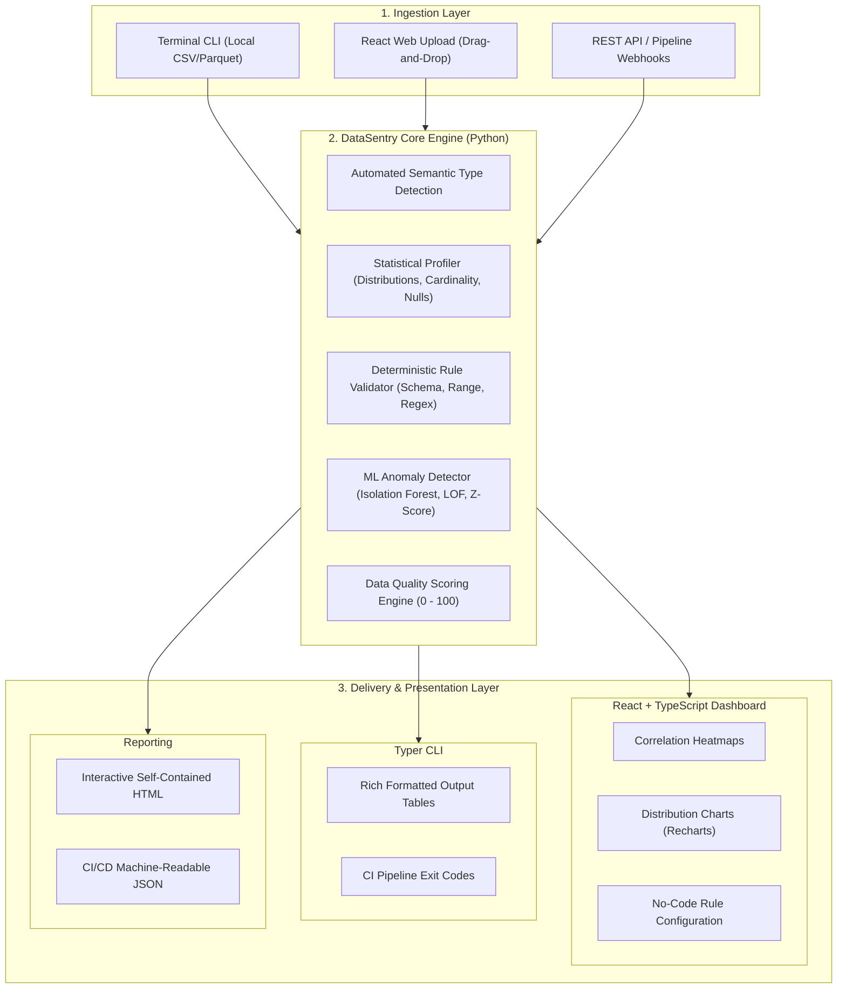

# 🛡️ DataSentry: All-in-One Data Quality Platform

<p align="center">
  
  
  
  
  
  
  
  
  
</p>

---

## 📌 Executive Overview

**DataSentry** is a unified, open-source data quality, profiling, and observability platform designed to bridge the gap between ad-hoc data validation scripts, statistical profiling tools, and ML-powered anomaly detection.

Instead of fragmenting data observability across disconnected tools, **DataSentry brings everything into a single, cohesive ecosystem**:
1. **Unified Data Core**: A shared Python engine powering both the developer CLI and the web API.
2. **Deterministic & ML Hybrid Validation**: Rule-based constraints (e.g., regex, schema integrity, value ranges) paired with unsupervised ML anomaly detection (Isolation Forests, Local Outlier Factors, dynamic IQR thresholds).
3. **Interactive React Dashboard**: Real-time visual profiling, interactive distribution histograms, correlation heatmaps, missing value matrices, and rule authoring.
4. **Developer CLI & CI Automation**: Zero-overhead command-line inspections and CI/CD quality gates for data pipelines.

---

## 🎯 The Problem & Our Solution

| The Pain Point | The DataSentry Solution |
| :--- | :--- |
| **Fragmented Tooling** (Using one script for profiling, another for schema checks, and external SaaS for dashboards) | **Single Unified Monorepo**: One Python core engine powering both the web platform and the terminal CLI. |
| **Silent Data Drift & Outliers** (Static rules miss complex multivariate distribution shifts and subtle anomalies) | **Hybrid ML Engine**: Unsupervised outlier detection (Isolation Forest, LOF) flag corrupted records that pass naive rule checks. |
| **High Setup Friction** (Complex enterprise data observability tools requiring heavyweight distributed clusters) | **Lightweight & Modular**: Runs locally with `pip` and `npm`, supports SQLite/DuckDB out of the box, and scales to automated CI workflows. |
| **Developer vs. Analyst Silo** (Engineers want CLI/code-based validation; analysts and stakeholders need intuitive visual reports) | **Unified Delivery**: Terminal outputs with Rich formatting + Exportable interactive HTML/JSON reports + Modern React Dashboard. |

---

## 🏗️ System Architecture

DataSentry follows a **Single Source of Truth** architecture: all validation, profiling, and ML detection routines live in the core Python engine. Both the FastAPI backend and the Typer CLI invoke this exact engine, guaranteeing identical results regardless of interface.



---

## ⚡ Tech Stack Breakdown

DataSentry combines **Production Machine Learning** and a **Modern Full-Stack Architecture**:

### 🧠 1. Machine Learning & Data Science Core
* **Core Data Engine**: `Pandas` and `Polars` for blazingly fast in-memory tabular processing.
* **Unsupervised Anomaly Detection**:
  * `Scikit-Learn` (Isolation Forest, Elliptic Envelope) for high-dimensional multivariate outlier detection.
  * `PyOD` (Python Outlier Detection toolkit) for Local Outlier Factor (LOF) and KNN-based density anomaly detection.
* **Statistical Inference**: `SciPy` & `NumPy` for skewness, kurtosis, Kolmogorov-Smirnov distribution tests, and dynamic IQR boundaries.
* **Semantic Type Detection**: Regular expression heuristics + NLP token categorization for detecting emails, credit cards, dates, coordinates, and UUIDs.
* **Intelligent Cleaning Recommendations**: Automated heuristic suggestions for missing-value imputation (mean/median/KNN) and deduplication.

### 🌐 2. Full-Stack Backend
* **API Framework**: `FastAPI` (Python 3.10+) with asynchronous endpoints for streaming file uploads and profiling.
* **Data Validation & Schemas**: `Pydantic v2` for strict typing and request/response serializing.
* **Execution & Job Management**: FastAPI BackgroundTasks for non-blocking profiling of large datasets.
* **Persistence (Optional)**: `SQLAlchemy` + `SQLite` (or `PostgreSQL`) for saving project datasets, profiling history, and validation rules.
* **Report Templating**: `Jinja2` for generating standalone, portable interactive HTML reports.

### 💻 3. Full-Stack Frontend
* **Core Framework**: `React 18` + `TypeScript` + `Vite` for lightning-fast HMR and type safety.
* **Styling & UI**: `Tailwind CSS` + `Lucide React` icons for a sleek, modern, responsive dark/light dashboard.
* **Data Visualization**: `Recharts` for distribution histograms, box plots, missingness heatmaps, and quality score radial gauges.
* **Data Grid**: `@tanstack/react-table` for exploring sample datasets and highlighting anomalous rows in real-time.
* **State & Networking**: `Axios` + React hooks for asynchronous dataset uploads and real-time processing indicators.

### 📟 4. CLI, Developer Tooling & DevOps
* **CLI Engine**: `Typer` paired with `Rich` for beautiful terminal tables, spinners, progress bars, and colored diagnostic outputs.
* **Testing & QA**: `pytest`, `pytest-cov`, and `httpx` for unit, integration, and API testing.
* **CI/CD**: `GitHub Actions` for automated linting (`ruff`/`black`), type-checking (`mypy`), and test execution on every pull request.
* **Containerization**: `Docker` & `Docker Compose` for one-command local orchestration.

---

## ✨ Key Features & Capabilities

```
+--------------------------------------------------------------------------+
|                            DataSentry Core Suite                         |
+--------------------------------------------------------------------------+
| [✓] File Ingestion      : CSV, TSV, Parquet, JSON lines via CLI or Web   |
| [✓] Deep Profiling      : Cardinality, null counts, memory, correlations |
| [✓] Deterministic Rules : Required fields, ranges, enum sets, regex      |
| [✓] ML Anomaly Detector : Multi-column outlier isolation & score flags   |
| [✓] Quality Scoring     : Weighted 0-100 score across 5 quality pillars  |
| [✓] Interactive Web UI  : Live charts, row-level filters, rule builder   |
| [✓] Terminal CLI        : One-command audits and CI exit-code gates      |
| [✓] Standalone Reports  : Shareable HTML & machine-readable JSON exports |
+--------------------------------------------------------------------------+
```

### 1. Unified Profiling
- **Column-level Metrics**: Null counts, distinct values, zeros, min/max/mean/std-dev, quantiles (25%, 50%, 75%, 99%).
- **Correlation Matrix**: Automatic Pearson & Spearman correlation calculation for numeric columns.
- **Missingness Pattern**: Detection of missing data patterns (MCAR, MAR, MNAR heuristics).

### 2. Dual-Layer Validation
- **Deterministic Rules Engine**:
  ```yaml
  rules:
    - column: age
      type: range
      min: 0
      max: 120
    - column: email
      type: regex
      pattern: "^[a-zA-Z0-9_.+-]+@[a-zA-Z0-9-]+\\.[a-zA-Z0-9-.]+$"
    - column: status
      type: allowed_values
      values: ["active", "pending", "suspended"]
  ```
- **ML Anomaly Detection**:
  - Automatically identifies anomalous rows based on multivariate feature combinations using an **Isolation Forest** trained on numerical features.
  - Generates row-level anomaly scores and flags records exceeding threshold tolerances.

### 3. Comprehensive Data Quality Score
Calculates an aggregate **Data Quality Score (0–100%)** based on 5 core pillars:
1. **Completeness**: Percentage of non-null and present values.
2. **Conformity**: Adherence to data type and formatting specifications.
3. **Uniqueness**: Absence of exact or near-duplicate records.
4. **Validity**: Adherence to business rules, boundaries, and domain constraints.
5. **Consistency / Plausibility**: Absence of multivariate ML-detected anomalies.

---

## 🚀 Quick Start Guide

### Prerequisites
- Python 3.10 or higher
- Node.js 18+ & npm (for frontend dashboard)
- Git

### 1. Clone & Set Up the Core Engine

```bash
# Clone the repository
git clone https://github.com/your-username/datasentry.git
cd datasentry

# Create and activate a Python virtual environment
python -m venv venv
# On Windows:
.\venv\Scripts\activate
# On Linux/macOS:
source venv/bin/activate

# Install datasentry core & backend dependencies
pip install -e .
```

### 2. Using the CLI (Immediate Analysis)

Analyze any CSV dataset instantly without launching a server:

```bash
# Profile a dataset directly in the terminal
datasentry profile data/sample.csv

# Run rule validation against a dataset
datasentry validate data/sample.csv --rules rules.yaml

# Run unsupervised ML anomaly detection
datasentry detect-anomalies data/sample.csv --contamination 0.05

# Export a full standalone HTML report
datasentry report data/sample.csv --output report.html --format html
```

### 3. Launching the Backend API & Web Dashboard

#### Start the FastAPI Backend:
```bash
# From the project root
uvicorn backend.main:app --reload --port 8000
```
*API documentation will be live at `http://localhost:8000/docs`.*

#### Start the React Dashboard:
```bash
cd frontend
npm install
npm run dev
```
*Dashboard will be accessible at `http://localhost:5173`.*

---

## 📂 Project Structure

```
datasentry/
├── .github/
│   ├── workflows/             # CI/CD: Automated tests, linting, code checks
│   │   └── ci.yml
│   ├── ISSUE_TEMPLATE/        # Standardized templates for bug reports & features
│   └── PULL_REQUEST_TEMPLATE.md
├── datasentry/                # 🧠 CORE ENGINE (Shared by CLI & Backend)
│   ├── __init__.py
│   ├── cli.py                 # Typer + Rich terminal commands
│   ├── profiler/              # Statistics, correlations, distribution engines
│   │   ├── __init__.py
│   │   └── engine.py
│   ├── validator/             # Rule-based validation logic
│   │   ├── __init__.py
│   │   ├── rules.py
│   │   └── schema.py
│   ├── ml/                    # 🤖 Machine Learning Anomaly Detection
│   │   ├── __init__.py
│   │   ├── isolation_forest.py
│   │   └── statistical.py
│   └── reporting/             # Jinja2 HTML & JSON report generators
│       ├── __init__.py
│       └── reporter.py
├── backend/                   # 🌐 FASTAPI APPLICATION
│   ├── __init__.py
│   ├── main.py                # Server entrypoint and route definitions
│   └── routers/
│       ├── profile.py         # Ingestion & profiling endpoints
│       └── validate.py        # Rule check & anomaly detection endpoints
├── frontend/                  # 💻 REACT + TYPESCRIPT DASHBOARD
│   ├── src/
│   │   ├── components/        # Reusable UI widgets, cards, charts, navbar
│   │   ├── pages/             # Dashboard, Upload, RuleBuilder, Reports
│   │   ├── hooks/             # Custom React state hooks
│   │   ├── services/          # API client (Axios)
│   │   ├── App.tsx
│   │   └── main.tsx
│   ├── package.json
│   ├── tailwind.config.js
│   └── vite.config.ts
├── tests/                     # 🧪 PYTEST SUITE
│   ├── test_profiler.py
│   ├── test_validator.py
│   ├── test_ml_anomaly.py
│   └── test_cli.py
├── data/                      # 📊 Sample datasets for testing & demos
│   └── sample.csv
├── pyproject.toml             # Python packaging & build configuration
├── requirements.txt           # Python dependencies
└── README.md
```

---

## 🤝 Open Source & SWOC Contributor Guide

DataSentry is proud to be built for open-source community collaboration (including **SWOC - Social Winter of Code**). We maintain beginner-friendly, well-documented issues across both Machine Learning and Full-Stack tracks.

### Contribution Tracks

```
Tracks Available:
├── 🟢 Good First Issue (Docs, CLI flags, Sample datasets, UI polish)
├── 🔵 Full-Stack & Frontend (React charts, rule builder, file drag-and-drop, API routes)
├── 🟣 Machine Learning & Data Science (PyOD integration, drift detection, imputation models)
└── 🟠 DevOps & Tooling (Docker compose, GitHub Actions, pre-commit hooks)
```

### Roadmap & Curated Issue Milestones

| Level | Feature / Milestone | Track | Status |
| :--- | :--- | :--- | :--- |
| **Beginner** | Add Parquet file ingestion support to Core Profiler | Python / Backend | `Ready` |
| **Beginner** | Design Dark Mode toggle and styling enhancements | React / Tailwind | `Ready` |
| **Beginner** | Add regex validation presets (Phone, SSN, Postal Codes) | Python / Validation | `Ready` |
| **Intermediate** | Implement Missing Value Heatmap using Recharts/SVG | React / Frontend | `Open` |
| **Intermediate** | Add PyOD Local Outlier Factor (LOF) detector option | ML / Data Science | `Open` |
| **Intermediate** | Support SQLite persistence for tracking dataset profiling history | Backend / FastAPI | `Open` |
| **Advanced** | Drift Detection: Compare baseline dataset vs incoming batch | ML / Statistics | `Roadmap` |
| **Advanced** | Auto-generating validation rules based on initial profile stats | ML / Heuristics | `Roadmap` |

### How to Contribute
1. Fork the repository and create your feature branch:
   ```bash
   git checkout -b feature/amazing-feature
   ```
2. Commit your changes with clear, descriptive messages:
   ```bash
   git commit -m "feat(ml): add local outlier factor anomaly detection"
   ```
3. Push to your branch and open a Pull Request!
4. Tag the relevant issue and await review from project mentors/maintainers.

---

## 📄 License

This project is licensed under the **MIT License** - see the [LICENSE](LICENSE) file for details.

---

<p align="center">
  Built with ❤️ for the Open Source Community. Let's make data reliable together!
</p>
